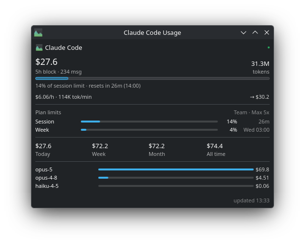

# Claude Code Usage — KDE Plasma widget

A Plasma 6 applet showing what Claude Code is actually costing you, and how
close you are to your plan's rate limits.



## What it shows

- **Plan limits** — the rolling session (5h) window, the weekly cap, and any
  model-scoped weekly caps, each with percent used and time to reset. Same
  figures as Claude Code's own `/usage`.
- **Rolling 5h block** — spend, tokens and message count for the current
  window, with burn rate and a projected close-out figure.
- **Period totals** — today, week, month, all time, optionally measured
  against cost budgets you configure.
- **Per-model breakdown** and **recent sessions**.

The headline gauge tracks your real session limit. If you set a block cost
budget in the config, it tracks that instead.

## How it gets the numbers

Two sources, because neither alone is complete:

| | source |
|---|---|
| Anything time-sliced (block, today, week, month) | `message.usage` on assistant turns in `~/.claude/projects/**/*.jsonl`, priced locally |
| All-time totals and the model breakdown | `cost-state` records, which include background Haiku calls that never reach a transcript |
| Plan rate limits | `GET https://api.anthropic.com/api/oauth/usage`, the endpoint Claude Code's own `/usage` reads |

Local pricing is reconciled against Claude Code's own recorded `costUSD`
figures — run `claude-usage --verify` to check every entry to the cent.

### About the token

The limits call authenticates with the OAuth access token that Claude Code
already stores in `~/.claude/.credentials.json`. It is only ever sent back to
the host that issued it. The collector never refreshes the token: on a 401 it
serves its cached figures and waits for Claude Code to refresh, because
rotating the refresh token here would log you out.

Responses are cached in `~/.cache/claude-usage/limits.json` for 120s
(`CLAUDE_USAGE_LIMITS_TTL`), so a 60s widget poll only hits the network every
other tick. If you would rather the widget never touched the network, set the
collector command to `claude-usage --no-limits` — it will run entirely from
local transcripts.

## Install

```sh
git clone https://github.com/JakeGT/claude-usage-plasmoid.git
cd claude-usage-plasmoid

install -Dm755 bin/claude-usage ~/.local/bin/claude-usage
kpackagetool6 --type Plasma/Applet --install .
```

Then right-click the desktop → *Add Widgets* → *Claude Code Usage*.

To upgrade an installed copy, `kpackagetool6 --type Plasma/Applet --upgrade .`
and restart the shell with `kquitapp6 plasmashell && kstart plasmashell`.

## The collector on its own

`claude-usage` is a standalone script; the widget just reads its JSON.

```
claude-usage             JSON for the widget (default)
claude-usage --text      pretty terminal report
claude-usage --daily 14  per-day table
claude-usage --limits    plan limits only  (--json for raw)
claude-usage --no-limits skip the network call, cached limits only
claude-usage --verify    reconcile computed cost against Claude Code's own
```

## Configuration

Right-click the widget → *Configure*:

- **Collector command** — defaults to `claude-usage`, found on `PATH` with
  `~/.local/bin` added.
- **Refresh interval** — default 60s.
- **Block / daily / weekly budgets** — optional cost ceilings, shown as
  percentages next to the period totals. Leave at zero to ignore.
- **Show** — plan limits, session limit percent in the panel, per-model
  breakdown, recent sessions.

## Requirements

Plasma 6, Python 3.9+, and a Claude Code install signed in to claude.ai.
Plan limits need a subscription; on API-key, Bedrock or Vertex auth the
endpoint returns nothing and that section is hidden.

## Licence

MIT
